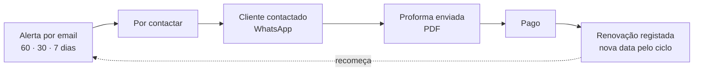
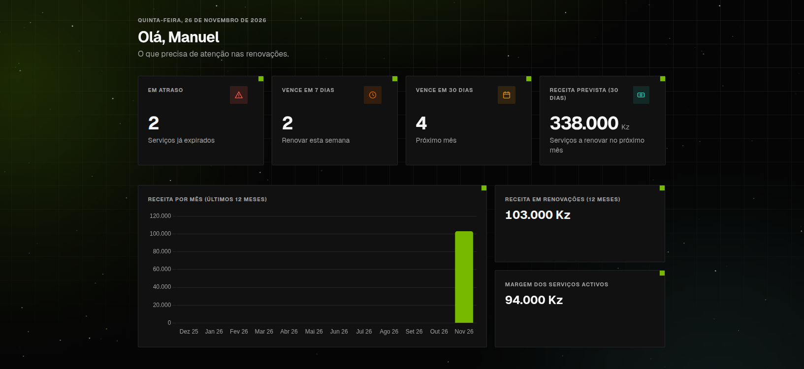
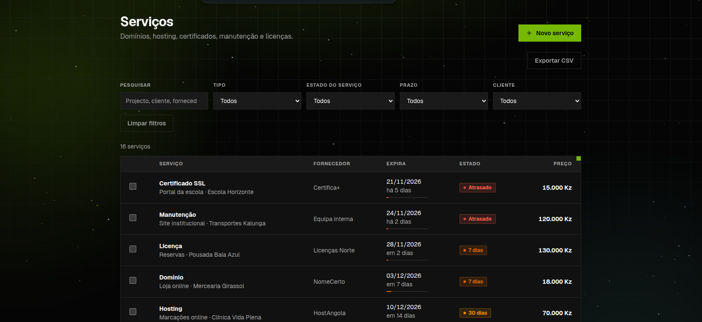
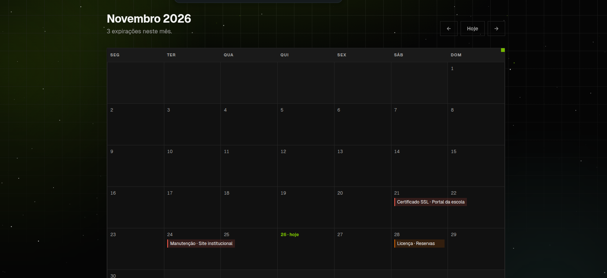

<div align="center">


# Painel de renovações

**Nenhum contrato expira sem ninguém ver.**

Domínios, hosting, SSL e licenças dos clientes num só painel, com alertas por email e a renovação registada num clique.


[Funcionalidades](#funcionalidades) · [Capturas](#capturas) · [Instalação](#instalação) · [Comandos](#comandos-de-gestão) · [Limitações](#limitações)

</div>

---

## Porquê

Numa empresa de desenvolvimento, cada cliente tem domínios, hosting e certificados com datas diferentes. Quando uma data passa sem ninguém dar por isso, o site do cliente cai e a empresa perde dinheiro e confiança. Este painel junta tudo num sítio, avisa antes de cada expiração e mostra quem já foi contactado.

> Projecto de estágio (Tunganetu / Instituto Técnico Comercial de Luanda). **Todos os dados de exemplo são inventados.**

## Ciclo de uma renovação



## Capturas



| Serviços | Calendário |
|---|---|
|  |  |

## Funcionalidades

**Controlo**
- Clientes, projectos e serviços, com pesquisa, filtros, paginação e exportação para CSV
- Painel com atrasados, 7 e 30 dias, receita prevista, margem e gráfico de 12 meses
- Calendário das expirações

**Renovação**
- Registo individual ou **em lote**, com a nova data calculada pelo ciclo (mensal a bienal)
- Estados de tratamento e notas por serviço
- Botão **Avisar por WhatsApp** com a mensagem já escrita
- **Proforma em PDF** (nunca mostra custo nem margem)
- Custo opcional em dólares, com câmbio actualizado por comando

**Automação**
- Alertas por email aos 60, 30 e 7 dias, sem repetir no mesmo ciclo
- Resumo semanal ao Administrador e ao Gestor
- Verificação do certificado SSL real

**Segurança**
- Login por email ou Google, **sem registo aberto**: só entra quem um administrador já criou
- Três perfis com permissões diferentes
- Histórico de actividade (quem fez o quê e quando)
- PWA instalável, que nunca guarda páginas com dados de clientes em cache

## Perfis

| Perfil | Pode |
|---|---|
| **Administrador** | Tudo, incluindo apagar e ver a Actividade |
| **Gestor comercial** | Criar e editar, renovar, exportar, proforma, WhatsApp |
| **Técnico** | Só ver os serviços dos projectos que lhe estão atribuídos |

## Stack

Django 6.1 · PostgreSQL 17 · django-allauth · HTMX · Tailwind 4 · Chart.js · ReportLab · Docker Compose

## Instalação

Precisas de [Docker](https://docs.docker.com/engine/install/) com Compose.

```bash
git clone https://github.com/manuelmtidi-lab/renovacoes-web.git
cd renovacoes-web
cp .env.example .env                                          # 1. preenche os valores
docker compose up -d                                          # 2. arranca db, web e tailwind
docker compose exec web python manage.py migrate              # 3. cria as tabelas
docker compose exec web python manage.py createsuperuser      # 4. o teu utilizador
docker compose exec web python manage.py dados_demo           # 5. (opcional) dados inventados
```

Abre **http://localhost:8000**. Usa sempre `localhost` e não `127.0.0.1`, por causa do login Google.

> ⚠️ Nunca uses `docker compose down -v`: apaga a base de dados.

Testes: `docker compose exec web python manage.py test servicos`

## Comandos de gestão

| Comando | O que faz | Frequência |
|---|---|---|
| `enviar_alertas` | Alertas de expiração (`--simular` mostra sem enviar) | Diária |
| `resumo_semanal` | Resumo ao Administrador e Gestor (`--simular`) | Segunda de manhã |
| `actualizar_cambio` | Actualiza USD/Kz e recalcula custos (`--manual 920`) | Semanal |
| `verificar_ssl` | Compara o certificado real com a data registada (`--aplicar`) | Semanal |

Corre-se com `docker compose exec web python manage.py <comando>`.

## Limitações

- Os emails saem para a consola até configurares SMTP no `.env`.
- O câmbio vem de uma fonte pública de mercado, não do BNA.
- `verificar_ssl` lê o certificado instalado no servidor, que pode não ser o contratado. Não verifica expiração de domínios.
- A Actividade não regista o que se faz no Django Admin nem pelos comandos.
- Falta a configuração de produção (Gunicorn, Nginx, HTTPS). Está planeada.

## Privacidade

Guarda-se apenas o contacto dos clientes (Lei n.º 22/11, Protecção de Dados Pessoais, Angola). Não se guardam palavras-passe de painéis de hosting ou de registadores. Nunca faças commit do `.env` nem de dados reais.
